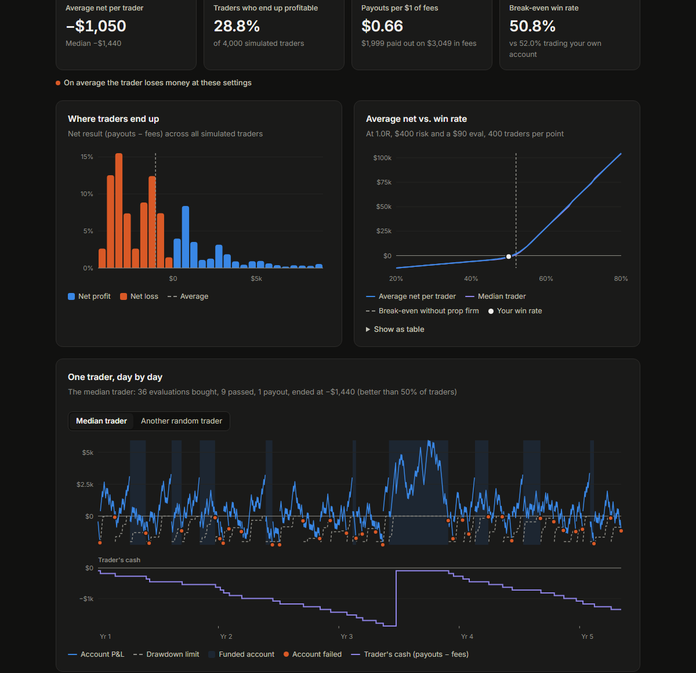

# Prop Firm Simulator

How much does a futures prop firm's rule set, rather than your trading, decide whether you make money?

This project simulates a typical $50k prop firm evaluation → funded account lifecycle with a one-trade-per-day
strategy, thousands of times over, and shows what traders actually end up with after fees and payouts.

**[Open the interactive simulator](https://asdtroll3.github.io/Prop-Firm-Simulator/)**



## The interactive page (`docs/index.html`)

A single static HTML file with no build step and no dependencies. Open it locally or serve it with GitHub Pages.

- **Trade setup:** win rate, reward:risk, risk per trade, evaluation price, optional monthly rebill
- **Execution and limits:** stop size (sets contract count and costs), slippage, max position, daily loss limit, fee budget
- **Firm rules:** profit target, trailing drawdowns, consistency rules, payout target and cap, profit split, activation fee,
  with Strict / Typical / Lenient presets
- **Results:** average and median net per trader, share of profitable traders, payouts per $1 of fees, break-even win rate,
  the distribution of outcomes, average net vs. win rate, cash needed and time to the first payout, and one trader's
  account and cash day by day
- **Trading period:** 1, 2, 3 years or the full ~4.4 years
- **Shareable links:** every setting is stored in the URL (`?wr=52&rr=1.5&risk=700`); use *Copy link to these settings*

It uses 4,000 simulated traders per setting. The same random draws are reused for every setting, so moving a slider
changes only that input.

### Synthetic vs. real NQ data

- **Synthetic** (always available): each day is an independent win or loss at the win rate you choose.
- **Real NQ data**: each day replays a real NQ session from the 10:00 ET open, in a random direction, with the stop and
  target checked against the actual 1-minute highs and lows and a 16:00 time exit. It needs `docs/nq_days.js`, which is
  not in this repository because it is derived from licensed market data; generate it from your own data
  (see below). Without it the page works in synthetic mode and the real-data button is disabled.

## Python backtest

```bash
pip install -r requirements.txt

# Monte Carlo backtest on 1-minute NQ data
python PropTest.py NQ_1Min.csv --start 2021-08-09 --paths 10000
python PropTest.py NQ_1Min.csv --rebill            # with monthly evaluation rebill

# Build docs/nq_days.js for the page's real-data mode
python export_days.py NQ_1Min.csv --start 2021-08-09
```

`PropTest.py` prints the raw strategy result and the prop firm result, and writes `prop_backtest_daily.csv` and
`prop_backtest_paths.csv`. Rules and costs are set in the CONFIG block at the top of the file.

### Data format

Market data is not included. You need 1-minute NQ (or MNQ) bars as CSV:

```
Date;Symbol;Open;High;Low;Close;Volume
1/2/2014 5:00 AM;NQH14;3.575,75;3.577,50;3.570,25;3.570,25;825
```

- Comma or semicolon separated; European (`3.575,75`) or plain (`3575.75`) numbers are detected automatically
- An optional first line starting with `Time Series` is skipped
- Timestamps in Chicago time (shifted +1 h to New York time; change `CSV_SHIFT_HOURS` otherwise)
- With several contracts in the file, the highest-volume contract of each day is used

## Model and assumptions

- One trade per day, entered at the 10:00 ET open with a bracket (stop and take profit), closed at 16:00 if neither is hit
- Commission $1.22 round turn per MNQ; slippage on entry and stop, none on the take-profit limit order
- Evaluation: $50k balance, end-of-day trailing drawdown that locks at the starting balance, profit target, optional consistency rule
- Funded account: starts at $0, end-of-day trailing drawdown that locks at $0, payout when cycle profit, minimum days and
  consistency are met; payout = min(% of balance, cap) × profit split
- A failed evaluation or blown funded account means buying a new evaluation; no resets (they usually cost more than a new account)
- Daily loss limit flattens the trade at the limit; it does not fail the account
- Real-data mode: targets are rounded to whole points; when stop and target fall in the same 1-minute bar the order is
  unknowable and settled by a coin flip

Not modelled: intraday trailing drawdowns, scaling plans, per-firm payout schedules and fine print, taxes.
The presets are generic and do not describe any specific firm.

## Credits

The strategy and the question come from two SSRN working papers:

- Youngblood (2026), The Inherent Value of Retail Prop Firms for Fixed-Size Trading Strategies - [SSRN](https://papers.ssrn.com/sol3/papers.cfm?abstract_id=7514219)
- Villahermosa (2026), Prop-Firm Challenges: A Barrier Model of Pass Rates and Expected Value - [SSRN](https://papers.ssrn.com/sol3/papers.cfm?abstract_id=7445798)

## Disclaimer

Educational tool only, not financial advice. Simulated results do not guarantee future results, and real prop firm
terms change often - check the current rules of any firm before buying an evaluation.
